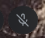

# DMS Voxtype Widget

A personal [DankMaterialShell](https://github.com/AvengeMedia/DankMaterialShell)
widget for keeping Voxtype dictation status and controls in my desktop bar.
It polls `voxtype status` every 500 ms and shows idle, recording,
transcribing, or stopped (model unloaded) states.



Actual bar capture with the Voxtype service stopped. A status/control popout
capture is still needed; see [capture notes](screenshots/README.md).

## Requirements

- A running DMS desktop with its plugin system available.
- `voxtype` on the shell's `PATH`, already configured for dictation.
- A systemd **user** service named `voxtype` for model load/unload and
  memory reporting.
- `notify-send` for the daemon-toggle notifications.

This widget wraps an existing Voxtype setup; it does not install Voxtype,
download a model, configure audio, or create the service. Check those first:

```bash
voxtype status
systemctl --user status voxtype
```

An inactive service is expected when the model is unloaded. A missing unit
needs to be set up before Load Model will work.

## Install

Clone directly into DMS's plugins directory:

```bash
mkdir -p ~/.config/DankMaterialShell/plugins
git clone https://github.com/Crambeary/dms-voxtype-widget \
  ~/.config/DankMaterialShell/plugins/VoxtypeWidget
dms restart
```

Then enable **Voxtype Widget** in **DMS Settings → Plugins** and add it in
**DMS Settings → Dank Bar → Widgets**. If you already have a checkout,
symlink it to that same `VoxtypeWidget` path instead of cloning again.

## Usage

| Action | Result |
| --- | --- |
| Left click | Open status and controls; start/stop recording, cancel while recording/transcribing, or load/unload the model. |
| Right click | Toggle recording. |
| Middle click | Start/stop the `voxtype` user service to load/unload the model. |

The popout also shows the model name when it can parse it from
`voxtype config`, and service memory usage when available. Memory saved by
unloading depends on your model; it is not a fixed amount.

## Limitations and troubleshooting

- Built around my Linux, DMS, and systemd setup; no compatibility matrix or
  minimum DMS/Voxtype version has been established.
- There are no configurable widget options. The service name is fixed.
- CLI failures do not have a dedicated error view. If the icon stays stopped
  or looks stale, run `voxtype status` and `systemctl --user status voxtype`
  in a terminal; a stopped icon alone does not prove the setup is healthy.
- Model-name parsing depends on the output format of `voxtype config`.

## Development

DMS plugins are not hot-reloaded automatically. After editing `Voxtype.qml`:

```bash
dms ipc call plugins reload VoxtypeWidget
```

Keep the plugin directory name and ID `VoxtypeWidget` case-sensitive.
